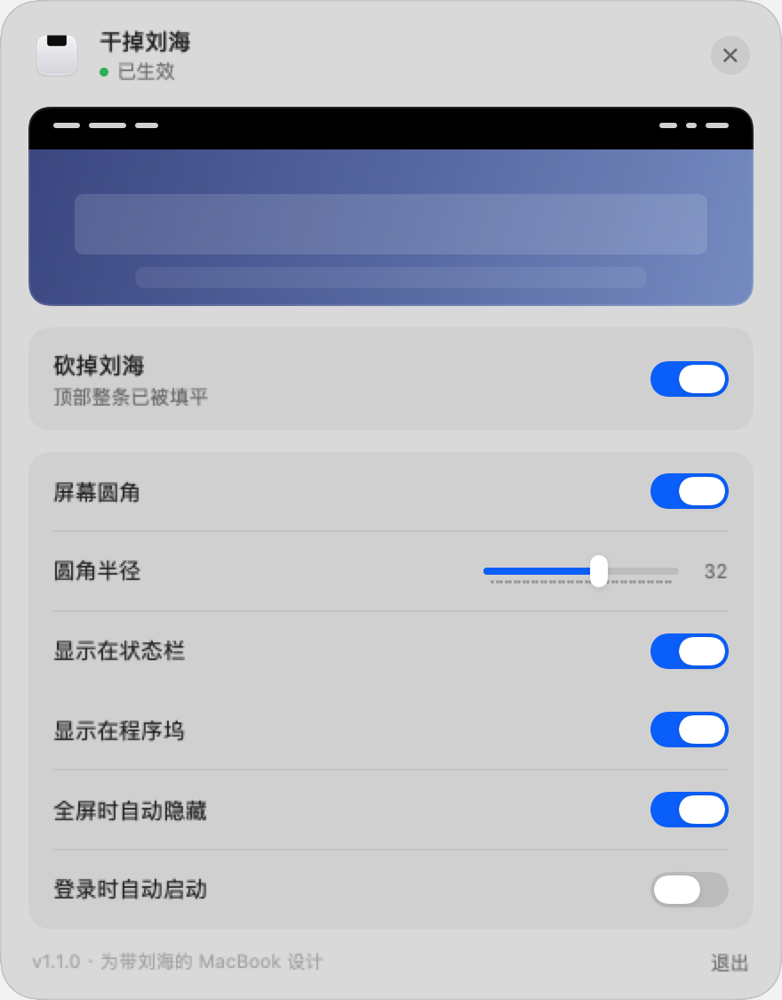
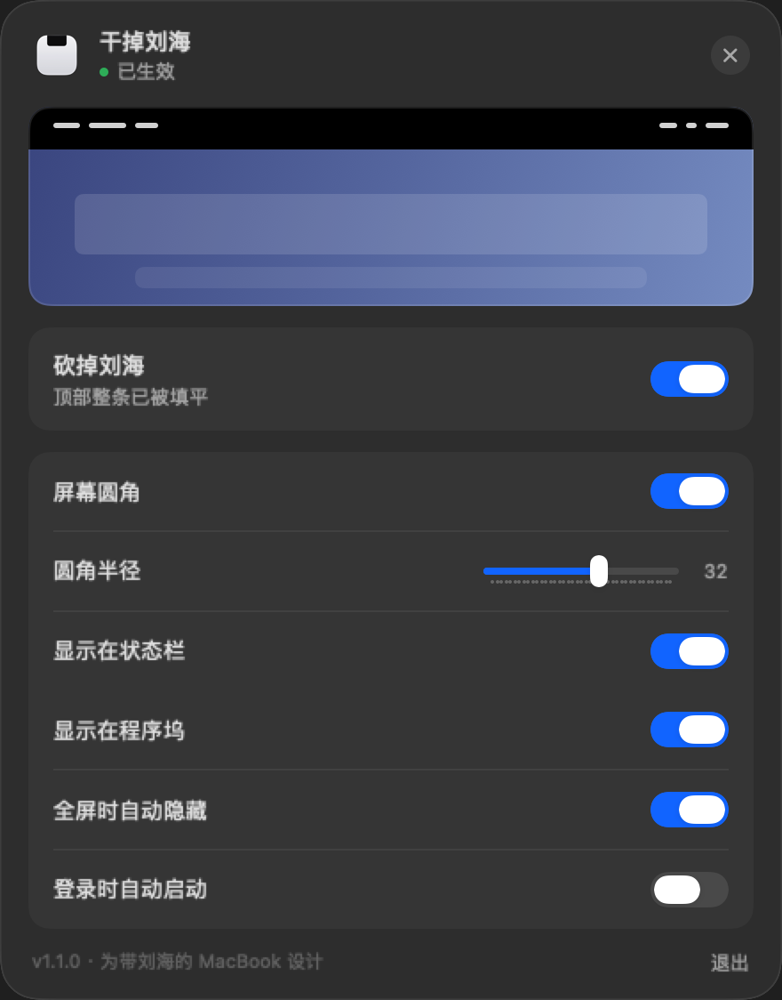

# 干掉刘海

把带刘海 MacBook 的菜单栏变成一条完整的黑色顶边，让刘海"看起来被砍掉了"。壁纸不改，随时可关。




> 截图稍后补，或用 `--render` 自己生成（见文末）。

## 特点

- **不动壁纸**：在菜单栏下方垫一层纯黑窗口，不是改图片
- **零输入监控**：不申请辅助功能权限，不监听键鼠，不联网
- **自动让位**：全屏应用、菜单栏隐藏、切到"刘海下方"分辨率时自动收起
- **多显示器安全**：只在带刘海的屏幕上生效
- **屏幕圆角**：给内置屏加圆角，半径可调；只画在桌面层，全屏与游戏不受影响
- **通用二进制**：Apple 芯片与 Intel 同一安装包

## 系统要求

- macOS 13 Ventura 或更高
- 带刘海的 MacBook（14/16 寸 MacBook Pro，M2 起的 MacBook Air）

没有刘海的机器可以安装，但不会产生效果。

## 安装

从 Releases 下载 `FuckBangs-1.3.1.dmg`，拖进「应用程序」。

首次打开会被 Gatekeeper 拦下（因为没有 Apple 开发者账号做公证）：

1. 双击一次，看到提示点「完成」
2. 系统设置 → 隐私与安全性 → 安全性 → 「仍要打开」
3. 输入密码，确认打开

macOS 15 之后「右键 → 打开」的旧绕过方式已失效，只能用上面这条路。

## 用法

- 状态栏图标 **左键**：快捷面板，五个开关直接切
- 状态栏图标 **右键**：菜单（打开主界面 / 停用 / 退出）
- 程序坞图标：打开主界面

## 从源码构建

不需要 Xcode 工程，只要装了 Xcode 命令行工具：

```bash
./build.sh     # 交叉编译 arm64 + x86_64，lipo 合并，安装到 /Applications
./package.sh   # 生成 dist/FuckBangs-1.3.1.dmg
```

重新生成图标：

```bash
swift tools/make_icon.swift Assets/icon_1024.png
```

## 调试参数

| 参数 | 作用 |
|---|---|
| `--selftest` | 打印屏幕参数、刘海宽度、登录项状态后退出 |
| `--render <dir>` | 把快捷面板和主界面离屏渲染成 PNG（配合 `NB_DARK=1` 出深色版） |
| `--show-window` | 启动后直接打开主界面 |
| `--show-quick` | 启动后直接弹出快捷面板 |

## 实现要点

- 浮层是 `NSWindow`，层级 `CGWindowLevelForKey(.mainMenuWindow) - 1`，垫在菜单栏下面、普通窗口上面，`ignoresMouseEvents` 让点击穿透
- 屏幕圆角用另一个窗口，层级 `-1`（桌面之上、窗口之下），用 even-odd 填充「整屏矩形 − 圆角矩形」只留四个角
- **顶部黑条也服从同一个圆角矩形**：黑条在四角跟着收进角落，露出壁纸形成黑色与内容的交界，四角才看得出弧度。否则黑压黑，顶部永远是直角
- 圆角窗口**不能用带 `canBecomeKey = false` 的子类**，会导致内容不参与合成、画了看不见；用原生 `NSWindow` 即可
- `NSWindow` 默认的 `constrainFrameRect` 会把窗口压到菜单栏下方，顶部黑条那个窗口必须重写
- 全屏检测不能靠 `visibleFrame`（不随全屏空间变化），改为在 `CGWindowList` 里找尺寸等于整屏的 layer 0 窗口
- 全屏时菜单栏消失会让浮层失去意义，因此检测到就收起

## 许可

MIT，见 [LICENSE](LICENSE)。
